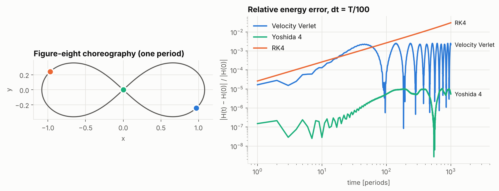
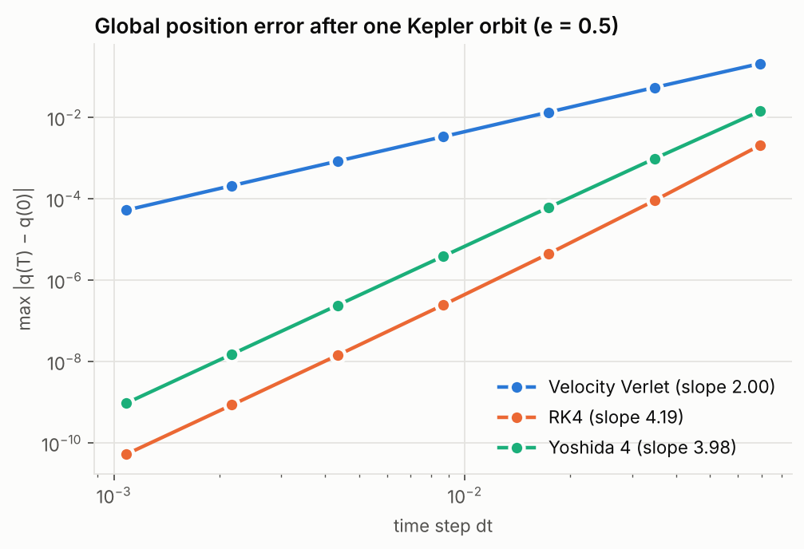
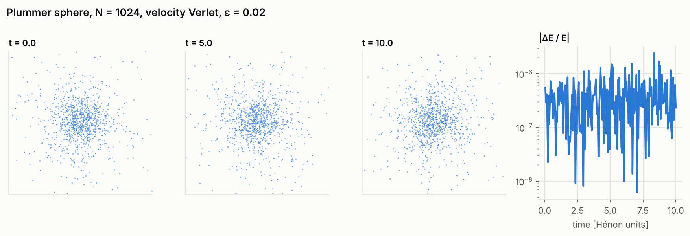
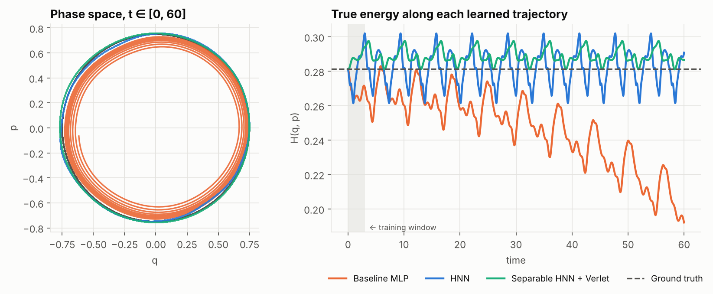

# JAX & Hamiltonian mechanics

**Write down an energy. Get the physics from autodiff.**

`hamjax` is a small, tested library for classical mechanics in [JAX](https://github.com/jax-ml/jax):

- **Forces by autodiff** — you implement the scalar `H(q, p) = T(p) + V(q)`; the force `−∂V/∂q` and velocity `∂T/∂p` come from `jax.grad`. No hand-derived pairwise force law anywhere.
- **Velocity-Verlet N-body integrator** — symplectic, time-reversible, one force evaluation per step (the force is carried between steps), plus a 4th-order Yoshida composition and an RK4 baseline.
- **Rollouts under `lax.scan`** — a million-step simulation compiles to one XLA loop; `save_every` thins the output with a nested scan so memory stays `O(n_steps / save_every)`.
- **Equinox modules throughout** — Hamiltonians, integrators and neural networks are all pytrees, so `jit`, `vmap` and `grad` compose with them freely.
- **Hamiltonian Neural Networks** — a reproduction of [Greydanus et al. (2019)](https://arxiv.org/abs/1906.01563) where the learned `H_θ` plugs straight into the same integrators.

<p align="center"></p>

> The figure-eight three-body choreography integrated for **1,000 periods at 100 steps per period**. RK4 is the more accurate method per step, yet its energy error grows without bound. Velocity Verlet's error is larger but **bounded** — it exactly conserves a nearby "shadow" Hamiltonian. That's what symplectic means in practice.

---

## Contents

- [Quickstart](#quickstart)
- [The physics in one screen](#the-physics-in-one-screen)
- [How the JAX pieces fit](#how-the-jax-pieces-fit)
- [Examples](#examples)
- [Hamiltonian Neural Networks](#hamiltonian-neural-networks)
- [Testing: verifying the geometry](#testing-verifying-the-geometry)
- [Repository layout](#repository-layout)
- [References](#references)

## Quickstart

```bash
git clone <this-repo> && cd jax-hamiltonian-mechanics
pip install -e ".[dev]"
```

```python
import jax

jax.config.update("jax_enable_x64", True)  # recommended for long-time conservation studies

import hamjax as hj

state, masses, period = hj.figure_eight()  # PhaseSpace(q=(3, 2), p=(3, 2))
H = hj.NBody(masses, G=1.0, softening=0.0)  # only the energy is defined

traj = hj.simulate(H, state, dt=period / 1000, n_steps=100_000, save_every=100)
traj.q.shape  # (1001, 3, 2)
hj.relative_energy_error(H, traj).max()  # ~2e-5 over 100 periods
hj.NBody(masses).force(state.q)  # = -jax.grad(H.potential)(q)
```

Defining a new system is just an energy:

```python
import jax.numpy as jnp


class AnharmonicChain(hj.SeparableHamiltonian):
    k: float = 1.0

    def kinetic(self, p):
        return 0.5 * jnp.sum(p**2)

    def potential(self, q):
        return jnp.sum(0.5 * self.k * jnp.diff(q) ** 2 + 0.25 * jnp.diff(q) ** 4)


q0, p0 = jnp.linspace(0, 1, 8) ** 2, jnp.zeros(8)
traj = hj.simulate(AnharmonicChain(), hj.PhaseSpace(q0, p0), dt=0.01, n_steps=10_000)
```

## The physics in one screen

Hamilton's equations for a state `z = (q, p)`:

$$\dot q = \frac{\partial H}{\partial p}, \qquad \dot p = -\frac{\partial H}{\partial q} \qquad\Longleftrightarrow\qquad \dot z = J\,\nabla H(z),\quad J = \begin{pmatrix}0 & I\\ -I & 0\end{pmatrix}.$$

For gravitating bodies with Plummer softening `ε`,

$$H = \sum_i \frac{|p_i|^2}{2m_i} \;-\; \sum_{i<j} \frac{G\,m_i m_j}{\sqrt{|q_i-q_j|^2+\varepsilon^2}}.$$

**Velocity Verlet** (kick–drift–kick) splits `H = T + V` and composes their exact flows:

$$p_{n+\frac12} = p_n + \tfrac{\Delta t}{2}F(q_n),\qquad q_{n+1} = q_n + \Delta t\,\nabla T(p_{n+\frac12}),\qquad p_{n+1} = p_{n+\frac12} + \tfrac{\Delta t}{2}F(q_{n+1}),$$

with `F = −∇V` from `jax.grad`. Each sub-step is the exact flow of a Hamiltonian, so the composite map is **symplectic** (`MᵀJM = J` for its Jacobian `M`), **time-reversible**, and — for pairwise central forces — conserves **linear and angular momentum to round-off**. Backward error analysis shows it exactly conserves a shadow Hamiltonian `H̃ = H + O(Δt²)`, which is why the energy error oscillates instead of drifting.

**Yoshida-4** composes three Verlet steps of sizes `w₁Δt, w₀Δt, w₁Δt` (with `w₀ < 0`!) to cancel the `O(Δt³)` error term while staying symplectic.

## How the JAX pieces fit

Each design choice maps onto an idea from the JAX docs:

| Idea | Where it lives | Why |
|---|---|---|
| **Pure functions & pytrees** ([Thinking in JAX](https://docs.jax.dev/en/latest/notebooks/thinking_in_jax.html)) | `PhaseSpace` is a `NamedTuple`; Hamiltonians and integrators are `eqx.Module`s | Everything is an immutable pytree, so `jit`/`vmap`/`grad`/`scan` see through it. |
| **`jax.grad` for forces** ([Autodiff Cookbook](https://docs.jax.dev/en/latest/notebooks/autodiff_cookbook.html)) | `SeparableHamiltonian.force`, `hamiltonian_vector_field` | `grad` of a scalar function of a `PhaseSpace` returns a `PhaseSpace` — `J∇H` is a swap and a sign flip. |
| **Structured control flow** (Thinking in JAX) | `rollout` — a nested `lax.scan` | A Python loop would unroll `n_steps` copies into the jaxpr; `scan` compiles the body once. |
| **Static vs. traced values** (Thinking in JAX) | `n_steps`, `save_every` are static; `dt` may be traced | Shapes must be known at trace time; a traced `dt` lets you `vmap` over step sizes without recompiling. |
| **NaN-safe gradients** (Autodiff Cookbook / FAQ) | the "double `where`" in `NBody.potential` | Masking `1/r` at `r = 0` in the forward pass isn't enough — the masked branch's `inf` gradient times `0` is `nan`. Substitute a safe value *before* the singular op. |
| **`jacfwd`, `jvp`** (Autodiff Cookbook) | the test suite | Symplecticity (`MᵀJM = J`), Liouville (`tr ∂ż/∂z = 0`) and `dH/dt = 0` are checked to machine precision. |
| **Differentiating through a solver** | `test_grad_through_rollout` | `jax.grad` of a loss on the final state, through 100 `scan` steps, agrees with finite differences to 1e-6. |
| **Equinox filtered transforms** ([Equinox](https://docs.kidger.site/equinox/)) | `eqx.filter_jit` on `simulate`, `eqx.filter_value_and_grad` in HNN training | Non-array fields (ints, activation functions) are treated as static automatically. |

### Integrator interface

```python
class AbstractIntegrator(eqx.Module):
    def init(self, H, state) -> carry           # VelocityVerlet caches F(q₀) here
    def step(self, H, carry, dt) -> carry       # one Δt; reuses the cached force
    def state(self, carry) -> PhaseSpace
```

`simulate` threads this through `rollout(step_fn, init, n_steps, save_every)`, which is generic — use it to roll out any `carry → carry` map (the HNN example uses it for an RK4 on a learned vector field).

## Examples

All scripts write their figures to `assets/`. Timings below are from a CPU-only cloud container.

```bash
python examples/figure_eight.py   # 1,000 periods: Verlet vs Yoshida-4 vs RK4 energy error
python examples/convergence.py    # measured order of accuracy; vmap over dt
python examples/plummer.py        # self-gravitating star cluster, N = 1024
python examples/train_hnn.py      # HNN vs baseline MLP (Greydanus et al. mass-spring)
```

### Order of accuracy — `examples/convergence.py`

<p align="center"></p>

Measured slopes on an `e = 0.5` Kepler orbit: **Verlet 2.00, Yoshida-4 3.98, RK4 4.19**.

### Star cluster — `examples/plummer.py`

<p align="center"></p>

1,024 equal-mass stars sampled from a Plummer sphere (Hénon units, `ε = 0.02`, `Δt = 2.5·10⁻³`), 4,000 steps of velocity Verlet (≈5 ms/step on CPU for the full `O(N²)` interaction):

| Quantity | Max deviation over the run |
|---|---|
| Relative energy error | 2.4 × 10⁻⁶ |
| Total momentum | 1.3 × 10⁻¹⁶ |
| Angular momentum | 6.8 × 10⁻¹⁷ |

Momentum conservation to round-off is a structural property: Newton's third law is built into a potential that depends only on `|qᵢ − qⱼ|`, and `jax.grad` respects it exactly.

## Hamiltonian Neural Networks

<p align="center"></p>

Following [Greydanus, Dzamba & Yosinski (2019)](https://arxiv.org/abs/1906.01563), an HNN learns a **scalar** `H_θ(q, p)` and defines the dynamics as its symplectic gradient `J∇H_θ`, trained by regressing onto observed `(q̇, ṗ)`:

```python
model = hj.HNN(dim=1, width=200, key=key)  # eqx.nn.MLP → scalar
loss, grads = eqx.filter_value_and_grad(hj.hnn_loss)(model, states, targets)
```

Because an `HNN` is a callable `PhaseSpace → scalar`, it **is** a Hamiltonian as far as `hamjax` is concerned: `hj.simulate(model, s0, dt=…, n_steps=…, integrator=hj.RK4())` just works. `SeparableHNN` restricts `H_θ = T_θ(p) + V_θ(q)` so the learned model can also use **velocity Verlet**, with the learned force `−∇V_θ` again obtained by autodiff.

On the paper's noisy mass-spring task (25 trajectories × 30 noisy samples, σ = 0.1, `t ∈ [0, 3]`), rolled out to `t = 60`:

| Model | Train loss | True-energy drift at t = 60 |
|---|---|---|
| Baseline MLP (predicts `ż` directly) | 0.036 | **−31.7 %** (spirals inward) |
| HNN + RK4 | 0.037 | +3.4 % (bounded oscillation) |
| Separable HNN + velocity Verlet | 0.040 | +1.9 % (bounded oscillation) |

All three fit the data equally well; only the ones with Hamiltonian structure generalise in time.

## Testing: verifying the geometry

```bash
pytest -q        # 27 tests, ~15 s on CPU
```

The suite checks properties, not just outputs:

- **Autodiff forces = Newton** — `jax.grad` matches a hand-written `O(N²)` force loop (2-D/3-D, with and without softening) to 1e-10.
- **Symplecticity** — `jax.jacfwd` of one Verlet / Yoshida step satisfies `MᵀJM = J` to 1e-11; RK4 provably does not.
- **Time reversibility** — 500 steps forward then 500 with `−Δt` returns to the start to 1e-10.
- **Exact momentum conservation** — `P` and `L` constant to 1e-13 for a 64-body cluster.
- **Bounded vs. secular energy error** — over 200 Kepler orbits.
- **Convergence order** — 2 for Verlet, 4 for Yoshida and RK4.
- **Liouville & energy conservation of the vector field** — `tr(∂ż/∂z) = 0` and `∇H · J∇H = 0` via `jacfwd`/`jvp`, including for *untrained* HNNs.
- **Composability** — `vmap` over initial conditions and step sizes; `grad` through a `scan` rollout checked against finite differences; `save_every` subsampling is consistent.
- **HNN learning** — recovers the oscillator Hamiltonian up to an additive constant.

## Repository layout

```
src/hamjax/
  hamiltonians.py       PhaseSpace, SeparableHamiltonian, NBody, HarmonicOscillator, Pendulum
  integrators.py        VelocityVerlet, Yoshida4, RK4, rollout (lax.scan), simulate
  diagnostics.py        energy, momentum, angular momentum, centre of mass
  initial_conditions.py figure-eight, Kepler two-body, Plummer sphere
  hnn.py                HNN, SeparableHNN, BaselineMLP, hnn_loss  (Equinox)
examples/               scripts that produce every figure in this README
tests/                  pytest suite (runs in float64)
assets/                 generated figures
```

## References

1. S. Greydanus, M. Dzamba, J. Yosinski. *Hamiltonian Neural Networks.* NeurIPS 2019. [arXiv:1906.01563](https://arxiv.org/abs/1906.01563)
2. JAX documentation — [Thinking in JAX](https://docs.jax.dev/en/latest/notebooks/thinking_in_jax.html) and [The Autodiff Cookbook](https://docs.jax.dev/en/latest/notebooks/autodiff_cookbook.html).
3. P. Kidger, C. Garcia. *Equinox: neural networks in JAX via callable PyTrees and filtered transformations.* [docs.kidger.site/equinox](https://docs.kidger.site/equinox/)
4. E. Hairer, C. Lubich, G. Wanner. *Geometric Numerical Integration.* Springer, 2006.
5. H. Yoshida. *Construction of higher order symplectic integrators.* Phys. Lett. A 150 (1990).
6. A. Chenciner, R. Montgomery. *A remarkable periodic solution of the three-body problem in the case of equal masses.* Annals of Math. 152 (2000).
7. S. J. Aarseth, M. Hénon, R. Wielen. *A comparison of numerical methods for the study of star cluster dynamics.* A&A 37 (1974).

## License

MIT — see [LICENSE](LICENSE).
